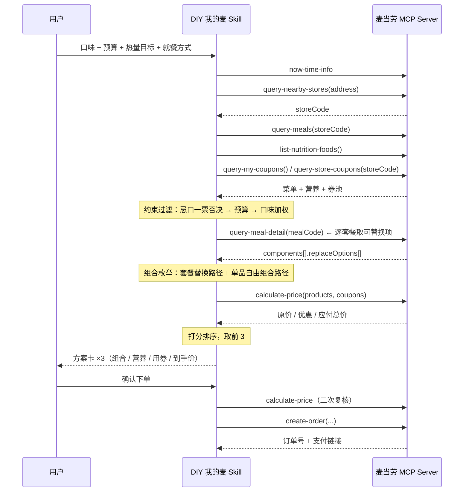

# MCP 集成说明

本文档说明「DIY 我的麦」实际接入的麦当劳 MCP Server、调用的 Tool、完整调用流程与业务价值。

## 1. 接入的 MCP Server

| 项 | 值 |
|---|---|
| Server 名称 | 麦当劳中国 MCP Server（`mcd-mcp`） |
| 接入地址 | `https://mcp.mcd.cn` |
| 传输协议 | Streamable HTTP |
| 鉴权方式 | 请求头 `Authorization: Bearer <MCP_TOKEN>` |
| Token 申请 | <https://open.mcd.cn/mcp> → 手机号登录 → 控制台 → 激活 → 复制 |
| 服务文档 | <https://github.com/M-China/mcd-mcp-server> |
| 限流 | 每 Token 每分钟 600 次请求（超出返回 `429`） |

脱敏配置示例见仓库根目录 [`mcp-config.example.json`](../mcp-config.example.json)，**只使用环境变量占位符**，仓库内不含任何真实 Token。

## 2. 调用的 Tool

本技能共使用 **11 个** 麦当劳 MCP Tool，其中 10 个为只读，1 个为写操作。

| Tool | 用途 | 读/写 |
|---|---|:---:|
| `now-time-info` | 校准当前时间，判断早餐/正餐/夜宵时段 | 读 |
| `query-nearby-stores` | 按用户地址定位可下单门店，拿到 `storeCode` | 读 |
| `query-meals` | 拉取门店可售卖餐品（餐品编码、分类、标签） | 读 |
| `list-nutrition-foods` | 拉取餐品营养成分（能量/蛋白/脂肪/碳水/钠/钙） | 读 |
| `query-meal-detail` | **读取套餐组成与可替换选项——DIY 能力的数据基础** | 读 |
| `query-my-coupons` | 查询账户内可用券 | 读 |
| `query-store-coupons` | 查询当前门店可用券 | 读 |
| `query-my-account` | 查询积分余额（可用/累计/冻结/即将过期） | 读 |
| `campaign-calendar` | 查询当月活动日历，判断是否值得等下一场 | 读 |
| `calculate-price` | **计算商品金额、配送费、优惠金额与应付总价** | 读 |
| `create-order` | 创建订单，返回订单详情与支付链接 | **写** |

> 另有 22 个本技能未使用的 Tool（商城、积分抽奖、派对预约等），完整 33 项清单见 [`references/mcd-tools.md`](../references/mcd-tools.md)。

## 3. 调用时序

## 4. 三个关键设计

### 4.1 价格只认 `calculate-price`

券的叠加规则（账号券 + 门店券 + 配送费减免 + 时段活动）在客户端不可复现。任何本地估算都可能和真实到手价不一致，进而误导用户下单。

因此引擎规定：**方案卡上出现的每一个价格，都必须来自 `calculate-price` 的返回**。离线演示模式（`--demo`）会明确标注数据源为「离线样例数据（非麦当劳真实菜单）」，不与真实结果混淆。

### 4.2 DIY 走「套餐内替换」优先

`query-meal-detail` 返回的 `components[].replaceOptions[]` 是套餐内可替换的商品及差价。套餐本身已含整包让利，在这条路径上做替换，通常比"单品自由组合"更省。

引擎因此采用双路径枚举：

- **路径 A**：套餐 + 套餐内替换（遍历各组件选项的笛卡尔积，单套餐上限 200 组，防止组合爆炸）
- **路径 B**：单品自由组合（主食 + 配餐 + 饮品 + 可选甜品）

两条路径的方案统一进入打分环节竞争，而不是人为优先。

### 4.3 写操作设安全闸门

`create-order`、`cancel-order`、`auto-bind-coupons`、`mall-create-order`、`draw-lottery`、`party-order-create` 均属写操作。SKILL.md 中明确要求：**只有用户明确说出"确认下单"类的授权表达，才能调用**；调用前还需重新 `calculate-price` 复核价格，与方案卡不一致就停下来告知用户。

## 5. 参数形态与降级策略

麦当劳官方文档公布了完整的 Tool 名称与语义，但**未公开各 Tool 的入参字段定义**（GitHub 仓库仅含 README）。因此本项目的做法是：

1. 客户端 [`scripts/mcd_client.py`](../scripts/mcd_client.py) 实现标准 MCP 握手（`initialize` → `notifications/initialized` → `tools/list` → `tools/call`），并正确处理 SSE 响应与 `Mcp-Session-Id` 会话头。
2. 运行 `python scripts/diy_mc.py tools` 可**从服务端实时拉取真实工具清单与字段定义**，据此校准入参。
3. `LiveSource` 中的入参按官方语义组织；若服务端字段定义有差异，以 `tools/list` 返回为准调整，不硬编码猜测。

降级策略：未配置 `MCD_MCP_TOKEN` 时，`python scripts/diy_mc.py demo` 使用内置样例数据跑通**完整的组合、打分、比价链路**，保证任何访客 clone 后无需 Token 即可验证算法正确性。

## 6. 业务价值

**用户侧。** 麦当劳菜单固定，但套餐内可换、部分餐品可特制——这个自由度没有被大多数点餐助手利用。本技能把"今天吃什么"从"翻菜单挑一个"变成"报出约束，拿到最优解"：一次交互同时解决口味、预算、热量、用券四件事，并且价格是后端算出来的真价，不是估的。

**平台侧。** 技能实质是在 MCP 的原子接口之上补了一层**编排与决策**：把 `query-meals` / `query-meal-detail` / `list-nutrition-foods` / `query-*-coupons` / `calculate-price` 这五个碎接口串成一条用户愿意每天用的闭环。券的利用率被显式量化并纳入排序目标（`W_COUPON` 权重），这会直接推动领券与用券，对发券方同样有利。

## 7. 安全与合规边界

- **Token 只走环境变量**：代码、配置示例、日志中均不出现真实 Token；仓库提交内容不含任何密钥。
- **写操作需显式授权**：见 4.3。
- **不做医疗或营养建议**：营养数据仅做客观呈现；用户提及减重、疾病等目标时，只做数据对照，并提示咨询专业人士。
- **不与其他品牌对比**：不评价、不贬低任何餐饮品牌。
- **不落盘个人数据**：配送地址、手机号等仅在会话内用于完成本次点餐，不写入任何文件。
- **请求频率自律**：按限流上限留出余量，对菜单与营养表做进程内缓存，避免重复拉取。
