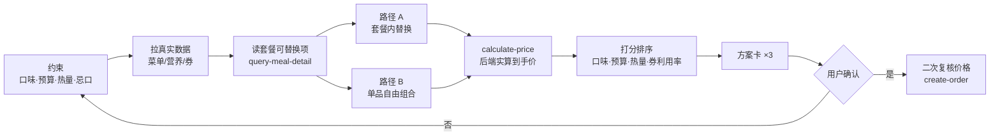

# 🍟 DIY 我的麦

> 麦当劳菜单是固定的，套餐里换什么，你说了算。

**「DIY 我的麦」** 是一个基于**麦当劳中国官方 MCP** 的 WorkBuddy Skill：你报出口味、预算、热量目标和就餐方式，它在你附近门店的**真实菜单**上现组一份专属套餐——优先走「套餐内替换」这条更省钱的路径，把营养、用券情况和**后端算出的真实到手价**一并摊开，你点头之后才下单。

一句话：**把「今天吃麦当劳点什么」变成一道有约束的定制题。**

---

## 它和普通点餐助手有什么不同

| 普通点餐助手 | DIY 我的麦 |
|---|---|
| 把菜单列给你自己挑 | 报出约束，直接给最优解 |
| 只会推荐现成套餐 | **会改套餐**——利用 MCP 1.0.5 的「更换套餐内商品组合」 |
| 价格靠估 | 价格全部来自 `calculate-price` 后端实算 |
| 只看价格 | 价格、热量、三大营养素、钠含量并排给出 |
| 券随缘用 | 券的利用率被显式量化并纳入排序 |
| 说一句就下单 | 写操作有安全闸门，价格二次复核后才下单 |

---

## 实际效果

```text
$ python scripts/diy_mc.py demo --budget 30 --kcal 700 --like 辣

【约束】口味=辣 · 预算≤¥30 · 热量 550–850 kcal · 外送(任意时段)
【数据源】离线样例数据（非麦当劳真实菜单）

🥇 方案 1 · 到手 ¥18.50（原价 ¥35.50，省 ¥17.00）
   组合：麦辣鸡腿堡 + 蔬菜沙拉 + 零度可乐(中) + 麦乐鸡(5块)
   套餐：麦辣鸡腿堡四件套
   DIY 替换：薯条(中) → 蔬菜沙拉；可口可乐(中) → 零度可乐(中)；麦辣鸡翅(2块) → 麦乐鸡(5块)
   营养：能量 785 kcal · 蛋白 39 g · 脂肪 38 g · 碳水 72 g · 钠 1790 mg
   用券：账号券 满30减12、门店券 满20减5
   为什么是它：命中口味：辣(麦辣鸡腿堡)；热量 785 kcal，落在目标区间；
              到手 ¥18.50，占预算 62%；用券 2 张，省 ¥17.00（利用率 48%）；
              走套餐路径，整包计价更划算

🥈 方案 2 · 到手 ¥18.50（原价 ¥35.50，省 ¥17.00）
   组合：麦辣鸡腿堡 + 蔬菜沙拉 + 零度可乐(中) + 麦辣鸡翅(2块)
   ...

🥉 方案 3 · 到手 ¥17.00（原价 ¥34.00，省 ¥17.00）
   组合：麦辣鸡腿堡 + 玉米杯 + 零度可乐(中) + 麦乐鸡(5块)
   ...

【状态】已完成：约束确认 → 数据拉取 → 组合试算 → 方案生成
        下一步需要你：选一个方案（或说"换个预算/口味"）
        未执行：下单
```

同一份套餐，换沙拉/换零度可乐/换麦乐鸡，到手价从 ¥18.50 一路压到 ¥17.00——**这就是"DIY"省出来的钱**。

---

## 快速开始

### 方式一：装进 WorkBuddy（推荐）

1. **申请麦当劳 MCP Token**
   打开 <https://open.mcd.cn/mcp> → 手机号登录 → 右上角「控制台」→「激活」→ 复制 Token。

2. **配置 MCP 连接器**
   WorkBuddy 左侧边栏【专家 · 技能 · 连接器】→【连接器】→ 右上角【自定义连接器】→【配置 MCP】，填入 [`mcp-config.example.json`](mcp-config.example.json) 的内容，并把 `${MCD_MCP_TOKEN}` 换成你的真实 Token：

   ```json
   {
     "mcpServers": {
       "mcd-mcp": {
         "type": "streamablehttp",
         "url": "https://mcp.mcd.cn",
         "headers": { "Authorization": "Bearer ${MCD_MCP_TOKEN}" }
       }
     }
   }
   ```

   保存后回到【自定义连接器】，把 `mcd-mcp` 打开（首次需点「信任」）。

3. **安装本技能**
   把 `SKILL.md` 与 `references/` 放到技能目录：
   - WorkBuddy：`~/.workbuddy/skills/diy-my-mc/`
   - 其他 Agent：放进对应 skills 目录即可（`SKILL.md` 是通用格式，不绑定特定框架）

4. **开聊**

   > 我想吃辣的，30 块以内，热量控制在 700 大卡左右，送到公司

### 方式二：命令行跑（无需 WorkBuddy）

```bash
git clone <本仓库地址>
cd diy-my-mc

# 离线演示：内置样例数据，零依赖、零 Token，可直接跑
python scripts/diy_mc.py demo --budget 30 --kcal 700 --like 辣

# 自助定制
python scripts/diy_mc.py diy --budget 25 --like 不辣 --no 牛肉 --period 早餐
python scripts/diy_mc.py diy --budget 30 --kcal 700 --like 辣,炸 --json

# 接真实麦当劳 MCP（需先设置 Token）
export MCD_MCP_TOKEN=你的Token      # Windows: set MCD_MCP_TOKEN=你的Token
python scripts/diy_mc.py probe      # 握手自检 + 打印工具清单
python scripts/diy_mc.py diy --live --budget 30 --like 辣
```

> Python 3.9+，**零第三方依赖**，只用标准库。

### 方式三：看演示页

直接用浏览器打开 [`demo/index.html`](demo/index.html)——单文件、断网可用、不需要 Token，滑杆调预算和热量就能看到组合与比价的全过程。

---

## 工作原理



**三条硬规则：**

1. **价格只认 `calculate-price`**——券的叠加规则客户端复现不了，本地估算一律不算数。
2. **DIY 优先走套餐内替换**——套餐本身已含整包让利，这条路通常更省。
3. **写操作有安全闸门**——`create-order` 等必须在用户明确授权后才调用，且下单前重新核价。

详细说明见 [`MCP_INTEGRATION.md`](MCP_INTEGRATION.md)。

---

## 用到的麦当劳 MCP 能力

共 11 个 Tool（10 读 + 1 写）：

`now-time-info` · `query-nearby-stores` · `query-meals` · `list-nutrition-foods` · **`query-meal-detail`** · `query-my-coupons` · `query-store-coupons` · `query-my-account` · `campaign-calendar` · **`calculate-price`** · `create-order`

完整 33 项清单见 [`references/mcd-tools.md`](references/mcd-tools.md)。

---

## 项目结构

```
diy-my-mc/
├── SKILL.md                  # 技能主体：6 个 Phase 的执行流程与硬规则
├── README.md                 # 本文件
├── MCP_INTEGRATION.md        # MCP 集成说明：工具、时序、设计取舍
├── CONTEST_DECLARATION.md    # 参赛声明（官方原文，内容未改动）
├── mcp-config.example.json   # 脱敏 MCP 配置示例（仅环境变量占位符）
├── workbuddy.md              # WorkBuddy 开发上下文
├── references/
│   └── mcd-tools.md          # 官方 33 个 Tool 清单与版本演进
├── scripts/
│   ├── mcd_client.py         # 零依赖 MCP Streamable HTTP 客户端
│   ├── diy_mc.py             # 组合、打分、券择优、计价与 CLI
│   └── mock_data.py          # 离线样例数据
├── demo/
│   └── index.html            # 单文件交互演示页（离线、无需 Token）
└── tests/
    └── crosscheck.js         # 交叉校验：确认网页版与 CLI 版引擎结果一致
```

跑一遍交叉校验（需 Node.js）：

```bash
node tests/crosscheck.js
```

它会用同一组约束分别驱动两套引擎，校验预算约束、价格勾稽、忌口生效、否定标签（如「不辣」不被当成「辣」）四项。当前状态：**全部通过**。

---

## 目标用户

- **想省钱但懒得凑单的人**：不想一张张比券，只想说个预算拿到最优解
- **在控热量的人**：想知道这一餐到底多少能量、怎么换能降下来
- **口味挑的人**：想改套餐里的配餐和饮料，但点餐页里翻来翻去找不到替换入口
- **每天中午要决定吃什么的人**：把它当"今天吃什么"的决策工具

---

## 安全性

- Token 只从环境变量读取，**代码、配置示例、日志中均不含真实凭据**
- 写操作（下单/取消/领券/抽奖/兑换）全部需要用户显式授权
- 配送地址、手机号等仅在会话内用于完成本次点餐，**不写入任何文件**
- 请求频率自律：菜单与营养表做进程内缓存，为官方 600 次/分钟的限流留出余量

---

## 常见问题

**Q：离线演示的数据是真的吗？**
A：不是。`scripts/mock_data.py` 里的菜单、价格、优惠券是为演示算法而虚构的**样例数据**，运行时会明确标注。真实数据一律通过麦当劳官方 MCP 实时获取。

**Q：为什么不在本地直接把券算出来，非要调 `calculate-price`？**
A：券的叠加规则（账号券 + 门店券 + 配送费减免 + 时段活动）在客户端不可复现，本地算出的价格可能与真实到手价不一致，进而误导下单。价格必须以后端为准。

**Q：能帮我下单吗？**
A：能，但只有你明确说"确认下单"之后才会。下单前还会重新核一次价，与方案卡不一致就停下来告诉你差异。

---

## 声明

本项目为**麦当劳程序员创意开发大赛参赛作品**，由参赛者独立开发，**非麦当劳官方产品**。项目输出仅供参考，不构成医疗、营养或其他专业建议；餐品信息、价格及供应状态以麦当劳官方渠道的实时结果为准。详见 [`CONTEST_DECLARATION.md`](CONTEST_DECLARATION.md)。

麦当劳 MCP 服务由麦当劳中国提供，使用须遵守其《使用条款》与《麦当劳 MCP 服务规则》，详见 <https://github.com/M-China/mcd-mcp-server>。
